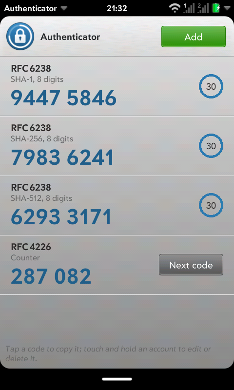
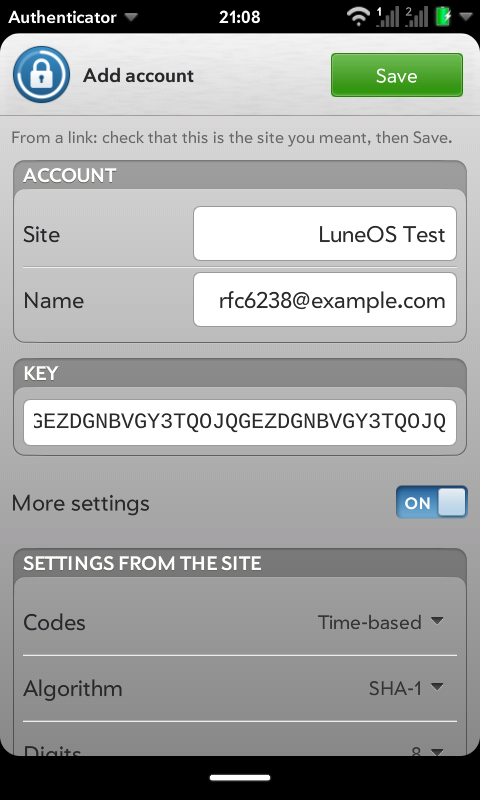
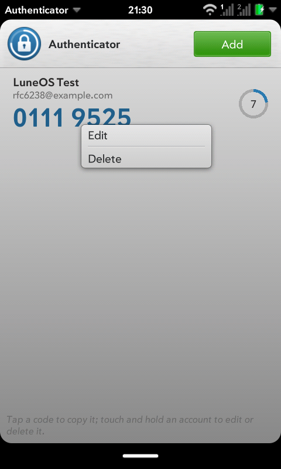
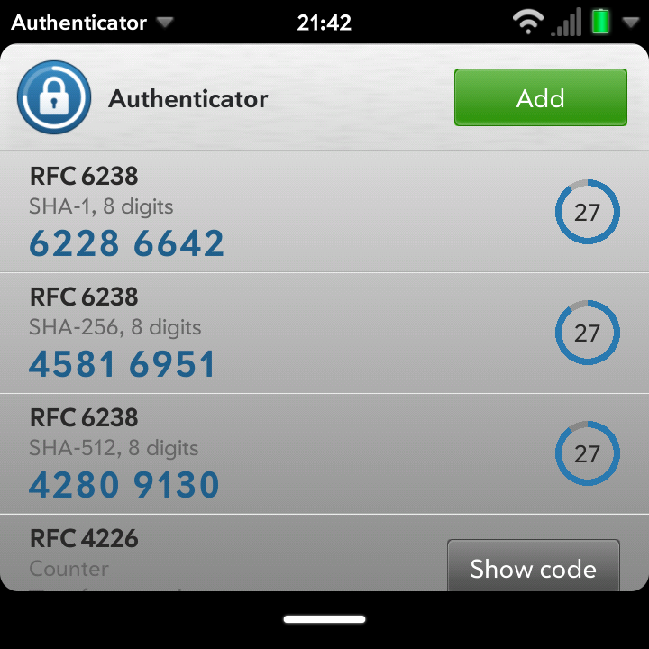

# Authenticator

One-time codes for two-step verification on LuneOS: time-based (TOTP,
RFC 6238) and counter-based (HOTP, RFC 4226).

- Accounts from a site's QR code: the Camera reads it and opens the
  otpauth:// link here. Any app that opens an otpauth:// link through the
  application manager does the same. The app shows what the link holds;
  nothing is added until you tap Save.
- Accounts typed in: the site's key (Base32, spaces and lower case are
  fine). Pasting a whole otpauth:// link into the key field fills in
  everything else. A key with a typo, such as a 0 where an O belongs or a
  character too many, is refused with the reason.
- SHA-1, SHA-256 and SHA-512; 6, 7 or 8 digits; any period from 1 to
  3600 seconds; the counter for counter-based codes.
- Tap a code to copy it. A ring shows how long the code has left and turns
  red for the last five seconds.
- A counter-based code is made only when asked ("Show code" / "Next
  code"), and the counter is saved before the code is shown.
- Touch and hold an account to edit or delete it. "Change the order" in
  the app menu puts Up and Down on the rows.
- The back gesture leaves the editor, closes a dialog and ends reordering.
- "Lock with fingerprint or passcode" in the app menu: from then on the
  app asks for an enrolled fingerprint or the screen lock passcode when
  it opens, and again after a minute in the background. With the lock on
  and a face enrolled in Settings, "Also open with a face" lets a face
  open it too, after a warning. See [The lock](#the-lock).

## Screenshots

The accounts are the RFC 6238 and RFC 4226 test keys.

| mindphone (480x800) | | | Q25 (720x720) |
|---|---|---|---|
|  |  |  |  |

## Where the accounts are kept

In the key manager (`com.palm.keymanager`), which encrypts what it stores
(AES-256-GCM under a device key, `/var/palm/keystore`) and keeps every
app's keys apart by the app id of the caller.

- Each account's key is stored under a name of its own
  (`otp.secret.<id>`), written once and never changed.
- Everything else (site, name, algorithm, digits, period, counter and the
  order) is in an index, also in the key manager. The key manager will not
  overwrite a key, so the index goes in turn to `otp.index.a` and
  `otp.index.b`, each with a generation number. The newer one counts; the
  other is the one before it, there if a write fails half way. A key is
  stored before the index that names it, and removed only after the index
  that drops it.
- If the key manager cannot be read when the app starts, the app says so
  and changes nothing: it never starts over with an empty list and writes
  that back.
- All keys are stored with `noexport`, so they stay on the device and are
  not part of a key manager backup. Moving to another device means adding
  the accounts again from the sites.

The site and account names are kept in the key manager rather than in
db8 or a settings file because they say which services the account
holder uses, and so that everything the app keeps is in one encrypted
place.

What this does not protect against: QML apps run as root, and the device
key sits next to the store, so anything running as root can read the
keys. A caller allowed to name another app id (`luna-send -a`) can fetch
that app's keys. The key manager in images up to now also writes stored
keys to the system log; a fix is on keymanager's
`herrie/no-key-material-in-logs` branch.

## The lock

With the lock on, the app asks who is holding the device before it reads
any secret from the key manager: a fingerprint, or the passcode the
screen is locked with (PIN, password or pattern), taken the way the lock
screen takes it.

- The fingerprint goes through `com.webos.service.fingerprint`
  (webos-fingerprint-adapter, biomd, the Android HAL). The sensor is armed
  only while the lock is shown and the app is in front, and given up after
  five touches that do not match; then only the passcode opens it.
- The passcode is checked by luna-authmanager (`matchDevicePasscode` on
  `com.webos.service.auth`), so wrong tries here count with the lock
  screen's, and share its lockout: after five, 30 seconds, then doubling.
  Under an Exchange policy with a retry limit, they also count towards
  that policy's wipe.
- A face, only when turned on ("Also open with a face", offered where a
  face is enrolled), through `com.webos.service.faceunlock`
  (luneos-faced). It is weaker than the others: the front camera sees
  only a picture, with no depth or infrared, and luneos-faced calls itself
  Android's "Class 1 / Convenience" tier. Someone who looks like you, or
  a good photo, can sometimes pass, so the app asks first and says so.
  Each try holds the camera for a few seconds, so there are at most three
  each time the app comes to the front, 2.5 seconds apart; "Try face
  again" gives three more. Five faces that do not match leave only the
  passcode, until the lock is next shown. An empty frame is not counted.
  If the Camera app holds the camera, the app says face unlock cannot be
  used just now and leaves it until asked again. Turning the lock off
  turns face off with it.
- The lock can only be turned on while the device has a screen lock
  passcode, so a sensor that stops working never shuts you out. If the
  passcode is removed later, the app says to set one in Screen & Lock
  and then takes that one.
- Locked, the app lets go of the secrets and the list and leaves any
  open page. A change being saved is finished first. An otpauth:// link
  that comes while it is locked opens once it is unlocked.
- Whether the lock is on is kept in the index (`"lock": true`, and
  `"face": true` with it), so it is
  as safe from change as the accounts are. An older version of the app
  leaves the flag out the next time it writes the index, which turns the
  lock off.

What the lock does not do: the keys in the key manager stay exactly as
they were, and the key manager hands them out without asking for a
fingerprint. Whoever can read them without the lock (root, or a caller
allowed to name the app id) still can. The lock is for the device in
someone else's hand, unlocked. The fingerprint count starts over each
time the app is opened; one count across all of the device's factors is
luna-authmanager's to keep, and it does not do that yet. The same goes
for face. webos-fingerprint-adapter and luneos-faced send identify
results to every subscriber, which is why the sensor and the camera are
let go whenever the app is not in front, and why a reply for an identify
the app has already let go of is ignored.

## Permissions

`requiredPermissions` in appinfo.json:

- `keymanager-service.operation`: store, fetch and remove keys.
- `application.launcher`: open the Camera from "Scan a QR code".
- `appmanager.management`: the application manager's handler table.
- `auth.query`: the screen lock mode (`getDeviceLockMode`).
- `auth.verify`: checking the screen lock passcode
  (`matchDevicePasscode`), without being able to set it. A new group, on
  luna-authmanager's `herrie/auth-verify` branch.
- `fingerprint.identify`: the sensor's status, `identify` and `abort`,
  without enrolling or removing fingerprints. A new group, on
  webos-fingerprint-adapter's `herrie/identify-group` branch.
- `faceunlock.identify`: the same for a face, without enrolling or
  clearing it. A new group, on luneos-faced's `herrie/identify-group`
  branch.

`"mimeTypes": [{ "scheme": "otpauth" }]` registers the app for
otpauth:// links; it is opened with `{"target": "otpauth://..."}`.

## Install for development

The app is QML and JavaScript only, so one package serves every device:

    tools/install.sh <adb serial>

It builds an "Architecture: all" ipk and installs it through
`com.webos.appInstallService`.

## Tests

    tools/run-tests.sh [path to luneos-components]

- `tests/js/run-node-tests.js` (Node): the published vectors (FIPS 180-4
  SHA-1/256/512, RFC 2202 and RFC 4231 HMAC, RFC 4226 HOTP, RFC 6238 TOTP
  with all three hashes, RFC 4648 Base32), each also recomputed with
  OpenSSL, then random inputs against OpenSSL: every message length from
  0 to 300 bytes, keys shorter and longer than the block, random counters
  and digits. Then otpauth:// parsing and the account checks.
- `tests/qml/tst_otp.qml` (qmltestrunner): the same vectors in QML's own
  JavaScript engine, the one the app runs in.
- `tests/qml/tst_ui.qml` (qmltestrunner, with luneos-components' desktop
  build and stand-ins): the app with `FakeKeyManager.qml` in place of the
  key manager, answering as the real one does. First start; RFC 6238
  codes shown end to end and following the clock; copying; adding typed
  and pasted keys; refused keys; duplicates; otpauth:// launches, also
  before the accounts are read; editing with and without a new key;
  deleting; reordering; counter-based codes; a key manager that refuses
  or never answers; the two index keys and a damaged one; a failed write;
  the back gesture; the app menu; the layout at 320x480, 480x800, 720x720
  and 1024x768. The lock, with `FakeAuth.qml` in place of luna-authmanager
  and the fingerprint service: no secret read while locked; PIN (pad and
  keyboard), password and pattern; wrong passcodes and the lockout; a
  refused check; no passcode set; a fingerprint that matches, misses,
  times out and is disarmed in the background; locking again after a
  minute away and while a change is being saved; links while locked; the
  lock screen's layout. Face: offered only with the lock and an enrolled
  face; asked first; off with the lock; never used unless turned on; a
  match; face, fingerprint and PIN together; three tries and "Try face
  again"; an empty frame not counted; five misses; a busy camera; let go
  in the background. `test_shots` saves pictures of the toast and the
  dialogs into `build/test-output/ui`, for comparing a change by eye.

`tools/mutation-check.sh` breaks the code in 52 ways, one at a time (the
hashes, the truncation, Base32, the index, the order of writes, the back
gesture, the lock and more), and checks that the tests fail for each.

On a device:

    [TAPS=1] [AWAKE=1] tools/test-device.sh <adb serial> <name>

It checks that otpauth:// links go to the app, puts the RFC test
accounts into the key manager, reads the codes off a screenshot with
tesseract and compares them with OpenSSL's for the device's time, opens a
link and checks the editor shows it, and with `TAPS=1` taps Save and
checks the key manager has the account. It removes its accounts at the
end and refuses to run where the app holds accounts of its own.

Passed on the Q25 (aarch64, without taps) on 2026-10-16. On the
mindphone (armv7, with taps) every check passed but the editor's, whose
screen reading missed the title; that check now also takes the
editor's "From a link" line, and has not been run there since.

## Icon

`images/icon.svg` is the icon; `tools/make-icon.sh` renders `icon.png` and
`icon-256x256.png` from it with Qt, as the launcher draws it. It is design
D3a of the sixteen in the legacy app icon style that
`tools/icon/make-variants.py` draws into `tools/icon/variants/`: a
combination lock dial numbered 0 to 35 inside a ring that runs down like a
code's remaining time. The SVGs use no filters, which Qt's renderer lacks.

## A recipe

A meta-webos-ports recipe would need what other QML apps have: install
appinfo.json, the icons, LICENSE and `qml/` to
`/usr/palm/applications/org.webosports.app.authenticator`, and luna-service2
role, manifest and client-permission files granting the groups above
(see Sound Recorder's `sysbus/`). It has nothing to build and no
architecture-specific files. RDEPENDS: qml-runner, luneos-components
(LuneOS.Forms, LuneOS.Components, LuneOS.Service, LuneOS.System,
LuneOS.Passcode; a version with LuneOS.Components' Toast and
ConfirmDialog.ask(), and the tests need StatusNotice's
`noticeCloseButton`), Qt Quick Controls, Qt Quick Shapes, the key manager
and luna-authmanager; webos-fingerprint-adapter where the device has a
sensor, and luneos-faced where face unlock is wanted.

## Licence

GNU General Public License version 3; see LICENSE.
